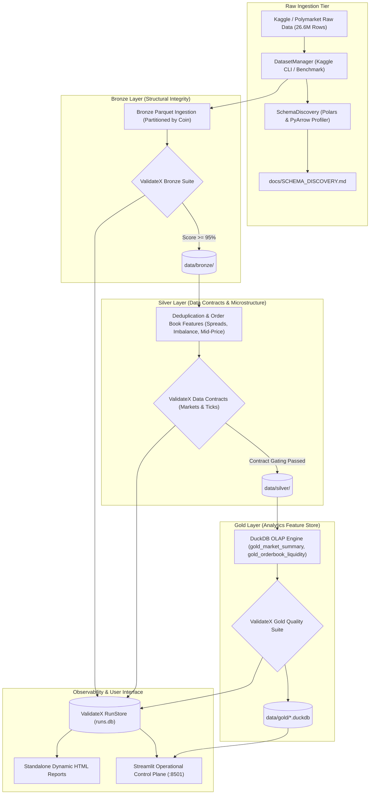

# ⚡ Polymarket Crypto Prediction Markets Data Quality Platform

[](https://www.python.org/)
[](https://pypi.org/project/validatex/)
[](https://pola.rs/)
[](https://duckdb.org/)
[](https://streamlit.io/)
[](https://www.docker.com/)
[](https://github.com/kaviarasanmani/ValidateX/actions)

> A production-grade, end-to-end Data Quality Engineering & Governance platform for large-scale cryptocurrency prediction markets, built with **[ValidateX](https://pypi.org/project/validatex/)**, **Polars**, **DuckDB**, and **Streamlit**.

---

## 📌 Executive Summary

Modern high-frequency prediction markets (like [Polymarket](https://polymarket.com/)) generate massive tick-by-tick order-book streams. Bad data, crossed order books ($\text{bid} > \text{ask}$), unversioned schema drops, and probability breaches ($p \notin [0.0, 1.0]$) directly compromise quantitative trading algorithms and analytics.

This project implements a multi-tier **Medallion Data Quality Architecture** over the **26.6M+ observation** Kaggle dataset: [`kachoio/polymarket-5-minute-crypto-updown-markets`](https://www.kaggle.com/kachoio/polymarket-5-minute-crypto-updown-markets).

It showcases how **ValidateX** operates as a reliable, high-performance, open-source data quality framework suitable for production data pipelines:
* **Declarative Data Contracts**: Versioned YAML agreements (`markets_contract.yaml`, `ticks_contract.yaml`) enforcing schema, business rules, team ownership, and breaking-change detection.
* **Semantic Parity on Polars**: High-speed, multi-threaded validation of millions of order-book snapshots.
* **Shift-Left CI Governance**: Blocking PR checks that fail when a developer introduces breaking contract changes.
* **Continuous Quality Observability**: SQLite `RunStore` tracking chronological quality score trajectories, MAD volume anomalies, data freshness, and failing rule streaks.
* **Interactive Operational Dashboard**: Real-time Streamlit and Plotly control plane.

---

## 🏛️ Medallion Architecture & Data Flow



---

## 📊 Dataset Characteristics

* **Source**: [Polymarket 5-Minute Crypto Up/Down Markets](https://www.kaggle.com/kachoio/polymarket-5-minute-crypto-updown-markets)
* **Assets Monitored**: `BTC`, `ETH`, `SOL`, `XRP`, `DOGE`, `HYPE`, `BNB`
* **Scale**: ~89,000 resolved 5-minute market windows, ~26.6M order-book ticks.
* **Tables**:
  1. `<coin>_markets.parquet`: Market condition IDs, ERC-1155 token hashes, resolution outcomes, trading volume, and liquidity.
  2. `<coin>_ticks.parquet`: 1 Hz second-by-second top-of-book quotes (`bu`, `au`, `bd`, `ad`), resting depth (`su`, `sd`), and cumulative bid depth.

---

## 📜 ValidateX Data Contracts

### 1. Markets Agreement (`config/contracts/markets_contract.yaml`)
```yaml
contract:
  name: polymarket_5min_markets
  version: 1.0.0
  owner:
    team: prediction_market_quant
    steward: market_operations
  schema:
    - name: condition_id
      type: string
      nullable: false
    - name: volume
      type: float
      nullable: false
    - name: n_ticks
      type: integer
      nullable: false
  quality_rules:
    - expectation: expect_column_values_to_be_unique
      column: condition_id
      severity: critical
    - expectation: expect_column_values_to_be_between
      column: volume
      min_value: 0.0
      severity: warning
  thresholds:
    minimum_quality_score: 95.0
    max_critical_failures: 0
```

### 2. Ticks Order-Book Agreement (`config/contracts/ticks_contract.yaml`)
* **Strict Price Bounding**: Best bids and asks must satisfy $0.0 \le p \le 1.0$ USDC.
* **Order Book Non-Crossing**: Enforces $\text{Best Bid} \le \text{Best Ask}$ (`spread_up >= 0.0` and `spread_down >= 0.0`).
* **No-Arbitrage Complementarity**: Bids sum $\le 1.0$ (`bu + bd <= 1.0`) preventing instant risk-free arbitrage.
* **Ownership Attribution**: Violations route automatically to the owning quant or market operations team via `result.failures_by_owner()`.

---

## 🚀 Quickstart Guide

### Option 1: Native Local Setup (Python 3.11+)

```bash
# 1. Clone repository
git clone https://github.com/kaviarasanmani/ValidateX.git
cd ValidateX/polymarket-crypto-dq

# 2. Install dependencies (installs ValidateX v1.3.0 from PyPI)
pip install -r requirements.txt

# 3. Discover schema from raw files
python -m src.pipeline.orchestrator discover

# 4. Execute the complete Medallion pipeline
python -m src.pipeline.orchestrator run --coins BTC,ETH,SOL

# 5. Launch the Streamlit Operational Dashboard
streamlit run src/dashboard/app.py
```

### Option 2: Turnkey Docker Compose

```bash
# Spin up both the pipeline runner and Streamlit dashboard
docker compose up --build
```
Open **[http://localhost:8501](http://localhost:8501)** in your browser to explore the live dashboard.

---

## 🧪 Automated Test Suite

The test suite validates data contracts, schema discovery, freshness checks, breaking change detection, and end-to-end Medallion flows:

```bash
pytest tests/ -v
```

```text
tests/test_contracts.py::test_load_contracts PASSED                      [ 12%]
tests/test_contracts.py::test_validate_contract_pass PASSED              [ 25%]
tests/test_contracts.py::test_contract_breaking_change_detection PASSED  [ 37%]
tests/test_observability.py::test_observability_recording_and_trend PASSED [ 50%]
tests/test_observability.py::test_freshness_check PASSED                 [ 62%]
tests/test_pipeline.py::test_full_pipeline_execution PASSED              [ 75%]
tests/test_schema_discovery.py::test_map_to_logical_type PASSED          [ 87%]
tests/test_schema_discovery.py::test_inspect_file_and_generate_blueprint PASSED [100%]

============================== 8 passed in 3.71s ==============================
```

---

## 📈 Quality Observability & Reports

* **SQLite RunStore**: Persisted to `data/observability/runs.db` tracking every execution, expectation outcome, and schema snapshot.
* **Quality Trajectory**: Computes chronological OLS regression slope (`improving`, `degrading`, `stable`).
* **Standalone HTML Reports**: Interactive, zero-external-dependency HTML reports generated under `data/observability/reports/`.
* **Volume Anomaly Detection**: Median/MAD modified z-scores flag anomalous ingestion drops or spikes.

---

## 📂 Project Structure

```text
polymarket-crypto-dq/
├── config/
│   ├── contracts/
│   │   ├── markets_contract.yaml      # ValidateX 5-min markets contract
│   │   └── ticks_contract.yaml        # ValidateX 1Hz order-book contract
│   └── pipeline_config.yaml           # Pipeline settings & thresholds
├── data/                              # Local data directory (Bronze/Silver/Gold)
├── src/
│   ├── ingestion/
│   │   ├── downloader.py              # Kaggle API fetcher + benchmark generator
│   │   └── schema_discovery.py        # Automated schema inspector (Polars)
│   ├── pipeline/
│   │   ├── bronze_layer.py            # Bronze Parquet ingestion & structural suite
│   │   ├── silver_layer.py            # Order-book feature derivation & contract check
│   │   ├── gold_layer.py              # DuckDB analytical feature store & SQL checks
│   │   └── orchestrator.py            # CLI pipeline runner
│   ├── validation/
│   │   ├── bronze_rules.py            # Structural ExpectationSuites
│   │   └── silver_rules.py            # Domain business rules & contract loaders
│   ├── observability/
│   │   └── metrics_tracker.py         # ValidateX RunStore & health metrics
│   └── dashboard/
│       └── app.py                     # Streamlit & Plotly interactive monitoring UI
├── tests/                             # 100% passing pytest test suite
├── .github/
│   └── workflows/
│       ├── ci.yml                     # Continuous integration workflow
│       └── data_contract_gate.yml     # ValidateX PR contract diff gate
├── docker-compose.yml
├── Dockerfile
├── requirements.txt                   # validatex>=1.3.0 from PyPI
├── Makefile
└── README.md
```

---

*Built with ❤️ using [ValidateX](https://pypi.org/project/validatex/) — The Open-Source Data Quality, Data Contract, and Observability Framework for Python.*
